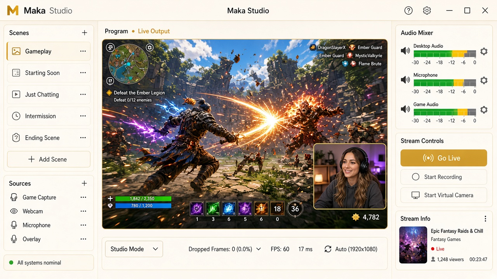

# Maka gaming streaming service

**The ultimate streaming software for gamers and creators who want a resource-light alternative.**



Maka is **free streaming software** for Windows—a **free streaming software obs alternative** built as a desktop **Electron studio** for capture, scenes, and **Go Live** without wiring up OBS first. A local **MAKA.relay** on `127.0.0.1:38473` takes WHIP from the app, encodes with FFmpeg, and pushes **RTMP** to Twitch, YouTube, or a custom RTMP endpoint. The app looks in `%LOCALAPPDATA%\MAKArelay` first and still reads `%LOCALAPPDATA%\TabcastRelay` for the encoder that is already installed. Stream keys stay in relay RAM — not written to disk by the UI.

**Website:** [tabcast.live.skydav.work](https://tabcast.live.skydav.work)

---

## Get Maka (v0.2.6 installer)

The current **unsigned** Windows installer on GitHub is **v0.2.6**. Installed copies of **v0.2.4** and **v0.2.5** check this release for an update. The build includes the **phone camera/mic add-on** (QR pairing, independent camera and mic, 60-second rejoin, STUN and optional TURN) and **live stream recovery** (a bad stream key stops the stream immediately, network blips retry longer, WHIP stall watchdog, backup RTMP ingest).

`git checkout v0.2.6` matches the published installer.

### Option A — Download (Windows)

1. Download **[Maka-Setup-0.2.6.exe](https://github.com/n0social/maka-streaming-software/releases/download/v0.2.6/Maka-Setup-0.2.6.exe)** from the [v0.2.6 release](https://github.com/n0social/maka-streaming-software/releases/tag/v0.2.6).
2. Run the installer on **Windows 10 or 11** (x64).
3. **Windows SmartScreen** may warn because the build is **unsigned** — that is expected until code signing is in place.

### Option B — Build from source (`main`)

```bash
git clone https://github.com/n0social/maka-streaming-software.git
cd maka-streaming-software
git checkout main
npm install
npm run fetch:relay
npm run dev
```

On Windows, `npm run dist` produces the NSIS installer. Use **`v0.2.6`** if you need a tree that exactly matches the published installer above.

---

## Recent updates

- **v0.2.6** — Addon protocol rename: preload exposes **`window.maka`**, manifests are **`maka-addon.json`**, sandbox pages load from **`maka-addon://`**, browse session uses **`persist:maka-browse`**, and catalog ids use **`com.maka.*`** (with migration from **`com.tabcast.*`**, including **`com.tabcast.phone-cam`** → **`com.maka.phone-cam`**). Relay paths and **`TabcastRelay.exe`** / **`TABCAST_*`** encoder env vars are unchanged; the app may also set **`MAKA_*`**.

---

## What it does

| Piece | Role |
|--------|------|
| **Studio** | Program monitor, display/window capture, webcam/mic, layers, destinations, Go Live |
| **Browse** | Multi-tab Chromium pane (Twitch, YouTube Studio, chat) with optional chat pop-out |
| **MAKA.relay** | Local encoder on port **38473** — WHIP in, RTMP out to your platforms |

---

## Phone camera & mic

In **v0.2.4**: optional add-on — pair your phone via **QR code**, use the phone as an independent camera and/or mic, **60s rejoin** if the connection drops, with **STUN** and optional **TURN**.

---

## Live stream recovery (v0.2.4)

Automatic reconnect with a **fatal-vs-blip** retry policy (ingest/key errors stop immediately; network blips retry longer), a **WHIP outbound video stall** watchdog, and optional **backup RTMP ingest** failover when primary ingest fails.

---

## Requirements

| | Download | Source build |
|---|----------|--------------|
| **OS** | Windows 10/11 (x64) | Windows 10/11 recommended for `npm run dist` |
| **Node.js** | Not required | **Node 22+** |
| **Relay binary** | Bundled in installer | `npm run fetch:relay` (~400 MB into `vendor/relay`) |

---

## Architecture

```
[Display / window / webcam / mic / optional phone]
        │  capture APIs
        ▼
[Maka Studio UI]  ──WHIP──►  [MAKArelay :38473]  ──RTMP──►  Twitch / YouTube / Custom
[Browse tabs / chat]
```

---

## Scripts

| Script | Purpose |
|--------|---------|
| `npm run dev` | Electron + Vite dev |
| `npm run build` | Production build to `out/` |
| `npm run preview` | Run built app |
| `npm run fetch:relay` | Fetch relay binary |
| `npm run verify` | Offline verification |
| `npm run dist` | Windows installer via electron-builder |
| `npm run dist:signed` | Signed release (needs `CSC_LINK` — see [docs/CODE-SIGNING.md](./docs/CODE-SIGNING.md)) |
| `npm run release:manifest` | Update `site/browser-manifest.json` from latest build |

## Privacy & safety

- Keys are not written to disk by the browser UI (relay RAM only).
- **Demo mode** (Settings) skips stream-key format checks — useful for walkthroughs and testing without real keys.
- **Browse stays on streaming sites** — the built-in browser can't open Maka download or project pages (keeps you on Twitch, YouTube, and chat).

---

## SmartScreen & trust

The v0.2.6 installer is **unsigned**. SmartScreen may block or warn on first run. Only download from the official GitHub release linked above.

---

## License

MIT — see [LICENSE](./LICENSE).

---

## Repository

`https://github.com/n0social/maka-streaming-software`

---

## Support

<p align="center">
  <a href="https://donate.stripe.com/cNi5kE6F7e3xg3EfOagMw00">
    
  </a>
</p>
