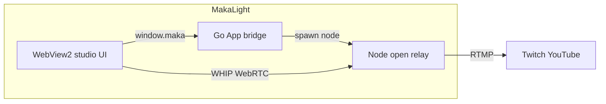

# MakaLight migration plan

**MakaLight** is the flagship downloadable studio: Go + WebView2 on Windows, reusing the Electron **renderer** layout without bundling Chromium. **Maka (Electron)** stays frozen in this repo as a benchmark baseline. **OBS** is the third arm in the resource study.

See also: [resource utilization analysis](./resource-utilization-analysis.md), [desktop-wails/README.md](../desktop-wails/README.md).

## Scope lock

| In scope | Out of scope (now) |
| --- | --- |
| `desktop-wails/` Wails app, Go bridge, relay spawn | Editing Electron `src/main/`, `src/preload/` |
| Frontend via `npm run makalight:bundle` | In-app browser / Search tab in **MakaLight** |
| Open `relay/` sidecar | Porting Electron browse `WebContentsView` |
| Benchmark harness under `benchmark/` | Addon marketplace in MakaLight Phase 1 |

## Architecture



| Electron (reference) | MakaLight |
| --- | --- |
| `BrowserWindow` + bundled Chromium | Wails + shared WebView2 |
| `contextBridge` → `window.maka` | `maka-bridge.js` + `go.main.App` |
| [`src/main/relay.ts`](../src/main/relay.ts) | [`internal/relay/manager.go`](../desktop-wails/internal/relay/manager.go) |
| `desktopCapturer` | Phase 1: WGC/DXGI in Go (stub today) |
| `loopback-capture` (game audio) | Phase 1: WASAPI in Go |

## Frontend sync (no Electron edits)

1. `npm run build` — electron-vite renderer → `out/renderer/`
2. `npm run makalight:sync` — copy to `desktop-wails/frontend/dist/`, inject `maka-bridge.js`, strip browser DOM from the **copy only** ([`scripts/sync-makalight-frontend.mjs`](../scripts/sync-makalight-frontend.mjs))

## IPC → Go matrix (MakaLight targets)

Electron exposes ~85 `ipcMain` handlers in [`src/main/index.ts`](../src/main/index.ts). MakaLight implements a **subset**; browser group is **never** ported.

| Group | Electron channels | MakaLight Phase |
| --- | --- | --- |
| Relay / WHIP | `relay:*`, `whip:*` | **0.1** (implemented) |
| App shell | `app:get-mode`, `app:set-mode`, `app:get-version-info`, `window:*` | **0.1** (partial) |
| Settings | `settings:get`, `settings:set` | **0.1** |
| Capture | `capture:list-sources`, `capture:set-preferred`, `window-audio:*` | **1** |
| Recording / scenes | `recording:*`, `scene:*` | **2** |
| Platform | `platform:viewers`, `platform:publish-metadata` | **2** |
| Diagnostics / QoS | `diagnostics:*`, `qos:export` | **2** |
| Addons | `addons:*`, `addon-runtime:*` | **3** (optional) |
| Browser | `browser:*`, browse capture | **never** |
| Updates | `app:update-*` | **2** |
| Phone cam | `phone-pair:*` | **3** |

## Implementation phases

### Phase 0.1 (current scaffold)

- Wails window loading synced studio UI
- `maka-bridge.js` stubs + relay/settings bindings
- Open relay spawn via `node relay/src/index.mjs`
- Windows dev: `cd desktop-wails && wails dev` (requires Wails CLI + WebView2)

### Phase 1 — Go Live MVP

- Native capture list + pick (WGC/DXGI)
- WASAPI game/window audio → PCM events
- WHIP path validated on WebView2 codecs
- Settings parity for stream keys / encode profile

### Phase 2 — Studio parity

- Recording, scene images, vcam window, diagnostics, tray, updates

### Phase 3 — Addons (optional)

- Sandboxed panels only — not a general browser

## Hurdles

| Issue | Mitigation |
| --- | --- |
| No `chromeMediaSourceId` | Native capture → canvas / frame push |
| WebView2 vs Electron WebRTC | Test H.264 WHIP against open relay |
| Relay child = Node + werift | Bundle `relay/` beside installer; `prepare:relay` |
| Linux/macOS | **Windows-first**; Wails build on Win CI |

## Visual differences

WebView2 usually matches Electron for Inter/League Spartan; program preview may differ if capture is not browser-based. **Search tab** UI is absent in MakaLight by design.

## Benchmark + paper

- Harness: [`benchmark/README.md`](../benchmark/README.md)
- Methodology: [resource-utilization-analysis.md](./resource-utilization-analysis.md)
- Outline: [docs/paper/outline.md](./paper/outline.md)

## Windows build

```bash
npm run prepare:relay
npm run makalight:bundle
cd desktop-wails
wails build -platform windows/amd64
```

Output: `MakaLight.exe` (NSIS when configured in `wails.json`).