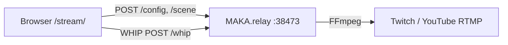

# Web relay testing (browser copy of desktop pipeline)

Test **capture → WHIP → local relay → (RTMP)** in the browser. The desktop Electron studio spawns the same open relay (`relay/`) and HTTP contract documented here (`src/shared/maka.ts`, `src/renderer/relay-client.ts`, `src/renderer/whip.ts`).

Production site: [makalive.stream/stream/](https://makalive.stream/stream/) · alias [makalive.stream/studio-web/](https://makalive.stream/studio-web/).

## Quick start

From the repo root (Node ≥ 22):

```bash
npm install
npm run dev:web-studio
```

This starts:

1. **Open MAKA.relay** on `http://127.0.0.1:38473` (`relay/src/index.mjs`)
2. **Static site** on `http://127.0.0.1:8765` (serves `site/`)

Open **http://127.0.0.1:8765/stream/** — add webcam/screen, **Apply config**, **Go live**.

Split processes:

```bash
npm run web:relay          # relay only
npm run dev:web-studio:site # site only (port 8765)
```

Automated API smoke (no browser):

```bash
npm run test:web-relay
```

## Relay HTTP API inventory

Base URL: `http://127.0.0.1:38473` (`RELAY_DEFAULT_PORT` in `src/shared/maka.ts`).

| Method | Path | Auth | Purpose |
| --- | --- | --- | --- |
| `GET` | `/health` | No | Liveness + `relayToken` + `streamUrl` |
| `GET` | `/status` | Bearer | Pipeline state, platforms, WHIP session, stats |
| `POST` | `/config` | Bearer | Stream keys + encode profile (RAM only) |
| `POST` | `/config/verify` | Bearer | Validate keys with platforms (mock accepts shape only) |
| `POST` | `/scene` | Bearer | Scene layout JSON (`SceneLayout`) |
| `POST` | `/stop` | Bearer optional in app | Tear down encode + WHIP |
| `POST` | `/whip` | Bearer | WHIP publish (`Content-Type: application/sdp`, trickle-less offer) |
| `DELETE` | `/whip/{id}` | Bearer | End WHIP session (`Location` from POST response) |

All mutating relay routes (including WHIP) use `Authorization: Bearer {relayToken}` from `GET /health`. The desktop app fetches `/health` immediately before each WHIP POST/DELETE so the token is never stale.

### `GET /health` → `RelayHealth`

```json
{
  "ok": true,
  "version": "0.1.0",
  "streamUrl": "http://127.0.0.1:38473/whip",
  "relayToken": "…"
}
```

The Electron app rewrites `streamUrl` to local WHIP via `localizeRelayHealth()`.

### `POST /config` → `RelayConfigRequest`

See `src/shared/relay-config.ts` / `buildRelayConfigRequest()`. Fields include `profile`, `bitrateMbps`, `maxBitrateMbps`, `rateControl` (`cbr`|`vbr`), `keyframeIntervalSec`, `bFrames`, `encoderPreset`, `twitchKey`, `youtubeKey`, `customRtmpUrl`, `customRtmpKey`, title/category, audio bitrates, encoder preferences. Profile `cloud720p30` is the low-CPU cap (2.5 Mbps, no B-frames, `ultrafast`). The studio may step the profile down while live when drops, RTT, or measured bitrate stay bad (`src/shared/encode-adapt.ts`). Open relay `relay/src` honors encode fields and applies `/config` while live.

### `GET /status` → `RelayStatusResponse`

`status`: `idle` | `starting` | `live` | `error` · optional `platforms`, `whipSessionActive`, `bitrateMbps`, `droppedFrames`, `latencyMs`, `ffmpegLog`, `error`.

The dev relay sets `latencyMs` from the selected WHIP candidate-pair round-trip and `droppedFrames` from inbound video `packetsLost`. It omits both until the peer reports them. The studio uses that relay latency when present, and otherwise the browser's own WHIP round-trip.

### CPU backpressure

The program compositor skips paints when a draw takes longer than the encode frame budget (`src/shared/encode-backpressure.ts`). While live, three slow or lossy samples pause the browser overlay track, and heavier loss also pauses the webcam track. The gameplay track stays. Restoring the extra tracks waits for three healthy samples.

### WHIP client contract (`src/renderer/whip.ts`)

1. Build `RTCPeerConnection`, add tracks on **named** `MediaStream`s (`gameplay`, `webcam`, `browser`, `mic`, `desktop-audio`, `game-audio`).
2. Create offer, gather ICE, `POST /whip` with SDP body.
3. Apply answer SDP; keep `Location` for `DELETE` teardown.
4. Prefer H.264 video codecs when publishing to real relay FFmpeg.

Web studio (`site/stream/stream.js`) sends canvas-as-`gameplay`, optional webcam PiP, mic — same msid pattern as the app.

## RTMP on Windows vs CI

On **Windows** with `FFMPEG_PATH` set, open relay pushes real RTMP. In CI / Linux, set `MAKA_RELAY_MOCK_RTMP=1` so FFmpeg is not required (WHIP + HTTP are still tested).

### Cloud gaming in the browser

Services like **GeForce NOW**, Xbox Cloud Gaming, or other browser tabs can be the gameplay source: choose **Tab or window** in the stream UI (`getDisplayMedia`) and pick the cloud-gaming tab. **Live** RTMP on Windows uses the same open relay as the Electron app.

## Architecture



Desktop flow is identical except capture runs inside Electron and the main process spawns `relay/src/index.mjs` (`src/main/relay.ts`).

## Related files

- `site/stream/` — browser studio UI
- `site/studio-web/` — redirect to `/stream/`
- `relay/src/` — **open source** MAKA.relay 0.1.1 (`npm run relay:open`)
- `scripts/web-studio-dev.mjs` — static site server
- `scripts/web-relay-smoke.test.mjs` — HTTP smoke test
