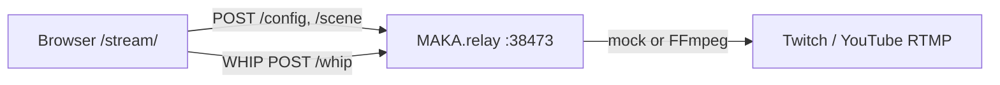

# Web relay testing (browser copy of desktop pipeline)

Test **capture → WHIP → local relay → (RTMP)** in the browser without downloading **MAKArelay.exe**. The desktop Electron studio uses the same HTTP contract documented here (`src/shared/tabcast.ts`, `src/renderer/relay-client.ts`, `src/renderer/whip.ts`).

Production site: [makalive.stream/stream/](https://makalive.stream/stream/) · alias [makalive.stream/studio-web/](https://makalive.stream/studio-web/).

## Quick start

From the repo root (Node ≥ 22):

```bash
npm install
npm run dev:web-studio
```

This starts:

1. **Mock MAKA.relay** on `http://127.0.0.1:38473` (`scripts/web-relay-dev.mjs`)
2. **Static site** on `http://127.0.0.1:8765` (serves `site/`)

Open **http://127.0.0.1:8765/stream/** — add webcam/screen, **Apply config**, **Go live**.

Split processes:

```bash
npm run web:relay          # relay only
npm run dev:web-studio:site # site only (port 8765)
```

Automated API smoke (no browser):

```bash
npm run test:web-relay
```

## Relay HTTP API inventory

Base URL: `http://127.0.0.1:38473` (`RELAY_DEFAULT_PORT` in `src/shared/tabcast.ts`).

| Method | Path | Auth | Purpose |
| --- | --- | --- | --- |
| `GET` | `/health` | No | Liveness + `relayToken` + `streamUrl` |
| `GET` | `/status` | Bearer | Pipeline state, platforms, WHIP session, stats |
| `POST` | `/config` | Bearer | Stream keys + encode profile (RAM only) |
| `POST` | `/config/verify` | Bearer | Validate keys with platforms (mock accepts shape only) |
| `POST` | `/scene` | Bearer | Scene layout JSON (`SceneLayout`) |
| `POST` | `/stop` | Bearer optional in app | Tear down encode + WHIP |
| `POST` | `/whip` | No* | WHIP publish (`Content-Type: application/sdp`, trickle-less offer) |
| `DELETE` | `/whip/{id}` | No* | End WHIP session (`Location` from POST response) |

\*Desktop WHIP publish does not send Bearer today; protected routes use `Authorization: Bearer {relayToken}` from `/health`.

### `GET /health` → `RelayHealth`

```json
{
  "ok": true,
  "version": "0.1.0",
  "streamUrl": "http://127.0.0.1:38473/whip",
  "relayToken": "…"
}
```

The Electron app rewrites `streamUrl` to local WHIP via `localizeRelayHealth()`.

### `POST /config` → `RelayConfigRequest`

See `src/shared/relay-config.ts` / `buildRelayConfigRequest()`. Fields include `profile`, `bitrateMbps`, `twitchKey`, `youtubeKey`, `customRtmpUrl`, `customRtmpKey`, title/category, audio bitrates, encoder preferences.

### `GET /status` → `RelayStatusResponse`

`status`: `idle` | `starting` | `live` | `error` · optional `platforms`, `whipSessionActive`, `bitrateMbps`, `droppedFrames`, `latencyMs`, `ffmpegLog`, `error`.

### WHIP client contract (`src/renderer/whip.ts`)

1. Build `RTCPeerConnection`, add tracks on **named** `MediaStream`s (`gameplay`, `webcam`, `browser`, `mic`, `desktop-audio`, `game-audio`).
2. Create offer, gather ICE, `POST /whip` with SDP body.
3. Apply answer SDP; keep `Location` for `DELETE` teardown.
4. Prefer H.264 video codecs when publishing to real relay FFmpeg.

Web studio (`site/stream/stream.js`) sends canvas-as-`gameplay`, optional webcam PiP, mic — same msid pattern as the app.

## What is 1:1 vs mocked

| Piece | Dev mock (`web-relay-dev.mjs`) | Real MAKArelay.exe |
| --- | --- | --- |
| HTTP paths + JSON shapes | Yes | Yes |
| `relayToken` + Bearer | Yes | Yes |
| WHIP SDP exchange | Yes (werift peer) | Yes (FFmpeg ingest) |
| RTMP to Twitch/YouTube | **Mocked** (console log only) | Yes |
| FFmpeg flags / NVENC | No | Yes |
| Tray / Windows install | No | Yes |
| Display/window capture | Browser `getDisplayMedia` only | Electron + OS capture |

Use the **mock relay** for UI and WHIP pipeline testing. Use **MAKArelay.exe** (or the Maka desktop app) to validate real RTMP ingest.

### Cloud gaming in the browser

Services like **GeForce NOW**, Xbox Cloud Gaming, or other browser tabs can be the “gameplay” source: choose **Tab or window** in the stream UI (`getDisplayMedia`) and pick the cloud-gaming tab. The **mock relay** is enough to exercise config, scene layout, and the WHIP path end-to-end without sending RTMP. **Live** delivery to Twitch or YouTube still requires **MAKArelay.exe** (or another server-side encoder) because the dev mock only logs RTMP instead of pushing it. Tab capture may fail on DRM-protected video, and extra encode + capture latency is normal compared to a native desktop capture pipeline.

## Architecture



Desktop flow is identical except capture runs inside Electron and the main process spawns `MAKArelay.exe` (`src/main/relay.ts`).

## Related files

- `site/stream/` — browser studio UI
- `site/studio-web/` — redirect to `/stream/`
- `scripts/web-relay-dev.mjs` — dev relay
- `scripts/web-studio-dev.mjs` — static site server
- `scripts/web-relay-smoke.test.mjs` — HTTP smoke test
